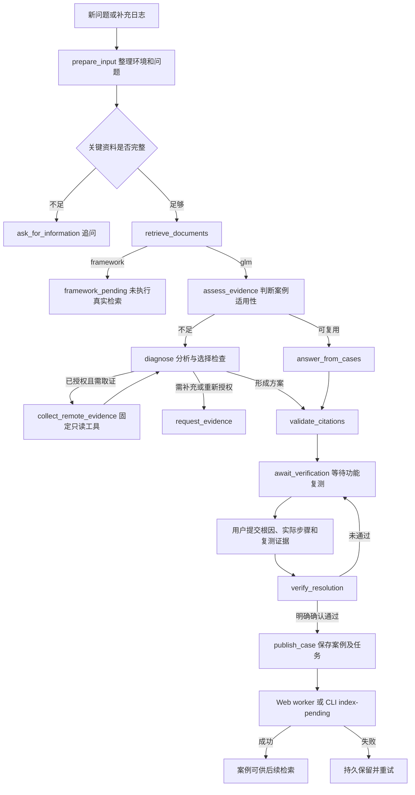

# 私有化部署助手工作流

教程 7 提供“补充信息 → 检索 → 案例复用或 GLM 诊断 → 只读取证 → 方案 → 功能验证 → 案例归档 → 入库”的业务入口。
LangChain 负责提示词、模型和结构化输出，LangGraph 负责节点、分支和持久化检查点。
代码路径存在不代表 GLM、SSH、向量库、Langfuse 远端或真实故障恢复已完成现场验证。

## 启动和续聊

在 Andrew 仓库根目录执行：

```bash
.venv/bin/python -m pip install -r 7_private_deployment_assistant/requirements.txt
.venv/bin/python 7_private_deployment_assistant/workflow_cli.py graph
.venv/bin/python 7_private_deployment_assistant/app.py
```

Web 地址为 <http://127.0.0.1:8070>。`graph` 输出实际 Mermaid，不调用模型、SSH 或向量库；
构造工作流会初始化本地 SQLite 和案例目录。
默认 `[assistant].mode="framework"` 不调用聊天模型、Embedding 或向量检索，可以学习追问流程：

```bash
.venv/bin/python 7_private_deployment_assistant/workflow_cli.py ask "离线安装失败" --thread-id demo-7 --request-id turn-1
.venv/bin/python 7_private_deployment_assistant/workflow_cli.py ask "1.32.8，Ubuntu，添加节点出现 ImagePullBackOff" --thread-id demo-7
```

真实问答需要准备数据库、已录入资料和模型密钥，再显式选择 GLM 模式：

```bash
# 会访问实际模型和向量库，可能产生模型调用费用。
.venv/bin/python 7_private_deployment_assistant/workflow_cli.py --mode glm ask "离线添加节点出现 ImagePullBackOff，下一步检查什么？" --thread-id incident-7 --request-id incident-7-turn-1 --k8s 1.32.8 --os Ubuntu --install-mode offline
```

顶级 `--mode framework/glm` 放在子命令前。GLM 读取 `ZHIPU_API_KEY`、`ZHIPU_CHAT_MODEL`、`ZHIPU_BASE_URL`，
优先级为进程环境、教程 7 的 `runtime/local.env`、仓库根 `.env`。不要把密钥放入 TOML、对话或案例。

## 执行图



追问、等待证据和等待验证均结束本轮 HTTP 请求，用户下一轮使用相同 `thread_id` 继续。
远程诊断最多循环 `[assistant].max_remote_rounds` 次，默认 2。
模型选择固定工具和参数，后端执行并返回证据。引用检查核对来源编号，不证明每句结论都有资料支持。
检索相似度、命令退出码和 Pod Running 均不能独立证明原故障已解决。

## 服务端状态与恢复

| 位置 | 内容 |
| --- | --- |
| `runtime/assistant.sqlite3` | 会话、幂等响应、案例版本、入库任务、Trace、usage 与反馈 |
| `runtime/checkpoints.sqlite3` | LangGraph 检查点和失败后的待执行节点 |
| `documents/source/assistant_cases/` | 脱敏 Markdown、metadata 和独立案例索引 |
| 当前进程内存 | 限时 SSH 凭据和连接引用，过期或进程退出即失效 |

已有会话以服务端历史为准，浏览器 `history` 仅用于初始化。相同会话同时只允许一个请求。
成功请求使用相同 `thread_id + request_id` 重试会返回已保存响应；失败请求使用同一 ID 可恢复待执行检查点。
新问题使用新 ID。失败节点的外部调用可能重试，不承诺所有外部操作恰好执行一次。
失败后的恢复请求使用新 Trace，并通过 `previous_trace_id` 关联前一次执行，便于统计实际重试消耗。
图已完成但响应尚未保存的重试直接恢复原 Trace 和结果，不重复调用模型或归档。
未完成的验证请求会保留脱敏后的复测表单，页面恢复后仍通过验证接口重试。
浏览器停止等待不保证后端终止。重启保留会话和检查点，SSH 连接需要重新授权。
数据库或模型执行错误返回失败，不能伪装成未检索到案例。

## 远程只读取证

窗口连接表单和 `POST /api/assistant/connections` 登记临时 SSH 连接，密码单独传输，不进入聊天、检查点或文档。
返回 `connection_id`，首次取证时才真正连接；登记成功不等于 SSH 已连接成功。
主机须在可信 `known_hosts` 中，或提供事先核验的 SHA256 主机指纹。

| 工具 ID | 检查内容 |
| --- | --- |
| `host_summary` | 系统、负载、内存和根分区 |
| `cluster_nodes` | 集群节点状态与版本 |
| `pods` | Pod 列表，可指定 namespace |
| `events` | 集群事件，可指定 namespace |
| `pod_describe` | 指定 Pod 详情与事件 |
| `pod_logs` | 指定 Pod 的有限日志，可指定容器与 previous |
| `helm_status` | 指定 Release 状态 |

`GET /api/assistant/diagnostics/catalog` 提供参数合同，`POST /api/assistant/diagnostics` 显式取证。
GLM 问答携带有效 `connection_id` 后，也可在预算内自动选择工具。
不执行任意 Shell、安装、重启、升级或配置修改。输出限制长度和时间，并脱敏后交给模型与观测。

## 功能验证和自动知识回流

用户实际完成处理后，通过窗口“确认解决”或 `POST /api/assistant/verification` 提交根因、实际步骤和原故障复测证据。
CLI 等价入口如下，占位文本必须替换为现场事实：

```bash
.venv/bin/python 7_private_deployment_assistant/workflow_cli.py verify incident-7 --root-cause "已确认的实际根因" --step "实际有效的处理步骤" --step "另一项实际步骤" --evidence "原故障功能复测的具体操作及结果" --confirmed
```

要求明确 `confirmed=true` 和具体功能证据。远程验证还要求至少一项检查且全部退出成功，仍不据退出码自动确认恢复。
案例包含环境、现象、明确根因与证据、实际步骤、功能验证、遗留事项和 Trace 引用。
不同根因不合并，独立维护 `assistant_cases` 索引，不修改已有 `codex_cases`，不复制原始对话或凭据。

发布先持久化案例和入库任务，之后写 Markdown 与 metadata；写文件或入库失败保留恢复依据。
文件原子替换，案例更新和入库使用跨进程文件锁，新版本淘汰旧的待执行任务。
“故障已解决”“文档已保存”“向量已入库”分别显示。
Web 在 `auto_index=true` 时自动启动 worker，默认每 15 秒处理任务，失败会重试。
CLI 不启动 worker，`verify` 也不自动访问向量库，需要显式执行：

```bash
.venv/bin/python 7_private_deployment_assistant/workflow_cli.py jobs --thread-id incident-7
# 会调用本地 Embedding 并写入当前配置的 Qdrant 或 pgvector。
.venv/bin/python 7_private_deployment_assistant/workflow_cli.py index-pending --limit 5
```

## Trace、Token、成本与反馈

每轮问答、验证和显式取证写入本地真实 Trace，同一故障通过 `thread_id` 聚合。
模型调用使用实际 usage，按模型与阶段统计；没有 usage 时标记缺失，不用字符串长度伪造 Token。
`model_call_count` 包含未返回用量和失败的调用，`missing_usage_count` 表示缺少完整用量的次数；
存在缺失时 Token 总计为 `null`，`known_*` 仅汇总已有完整用量的部分。
没有价格的费用为 `null`。反馈接口记录 0～1 分和评论，并关联回答 Trace。

```bash
.venv/bin/python 7_private_deployment_assistant/workflow_cli.py sessions
.venv/bin/python 7_private_deployment_assistant/workflow_cli.py metrics
.venv/bin/python 7_private_deployment_assistant/workflow_cli.py metrics --thread-id incident-7
```

`GET /api/evaluations` 返回本地真实 Trace 和统计，不是固定问题集质量评测报告。
`[langfuse].enabled=false` 默认关闭远端上报；开启后从环境读取 `LANGFUSE_PUBLIC_KEY`、`LANGFUSE_SECRET_KEY`，
地址使用 `LANGFUSE_BASE_URL` 或 `[langfuse].base_url`。远端上报失败和 usage 缺失均不能视为零消耗。
关闭工作流会 flush 观测并释放 SQLite，CLI 所有退出路径也会清理。

## 配置和 API

| 配置节 | 字段 | 功能 |
| --- | --- | --- |
| `[assistant]` | `mode`、`model`、`base_url`、`top_k`、`max_remote_rounds` | 模式、模型与检索/诊断预算 |
| `[business]` | `runtime_dir` | SQLite 和锁目录 |
| `[business]` | `auto_index`、`index_interval` | Web 自动入库与轮询秒数 |
| `[business]` | `connection_ttl`、`command_timeout`、`max_output_chars` | 连接有效期、命令超时及输出上限 |
| `[business]` | `known_hosts_path`（可选） | 自定义可信主机文件 |
| `[langfuse]` | `enabled`、`base_url` | 上报开关和地址，密钥只从环境读取 |

业务接口公共前缀为 `/api/assistant`：

| 路径 | 功能 |
| --- | --- |
| `POST /messages`、`GET /sessions` | 问答、恢复及会话列表 |
| `POST /connections`、`DELETE /connections/{connection_id}` | 登记/撤销临时连接 |
| `GET /diagnostics/catalog`、`POST /diagnostics` | 固定检查目录和取证 |
| `POST /verification`、`POST /feedback` | 功能验证及回答反馈 |
| `GET /metrics`、`GET /index-jobs` | 统计及入库任务列表 |
| `POST /index-jobs/retry` | 唤醒 Web worker |

`POST /index-jobs/retry` 仅唤醒 worker，`auto_index=false` 时不会替代 CLI 执行。完整字段合同见 `/docs`。

## 验证边界与后续工作

隔离测试可注入假模型、假 SSH 和假 ingestor 验证流程、重启恢复和队列，不构成真实外部服务或现场恢复的证明。
仍需补充 Web 安装器自动读取集群配置、专项功能复测工具、固定问题集批量评测、引用支持评分、用户账号及多租户权限。
当前不提供修改集群的执行器。

SDK 接口参考：[LangGraph 持久化](https://docs.langchain.com/oss/python/langgraph/persistence)、
[Langfuse LangChain 集成](https://langfuse.com/integrations/frameworks/langchain)。
