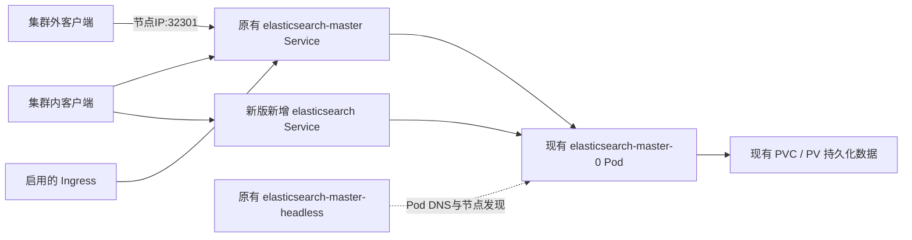

# HELM-37：Elasticsearch两版部署设计、Service兼容与手动升级

项目：g_kube_installer。记录日期：2026-10-15。记录状态：源码结论，已离线渲染核对；现场功能待验证。

适用环境：本地 test 分支 HEAD `9094b52`，当前 `cmd/kk/pkg/component/elasticsearch.tgz`；Chart 7.15.0。适用于使用该包的 KK 组件安装（在线/离线），没有连接具体集群；不能据此确认旧二进制或已有 Helm release 的实际资源。

## HELM-37 部署版本设计与访问拓扑

整理日期：2026-10-15。这里的旧版/新版指两个 Git 提交中的安装包设计，ES 引擎引用都为 7.15.0，不是 7.x 到 9.x 的升级。本文也包含命令、参数和手动补入口 YAML，均未在用户现场执行。

| 设计项 | 旧包 a4ee37f（2026-08-31，wangfei） | 新包 f118789（2026-09-18，panwp） |
|---|---|---|
| Chart / appVersion | 7.15.0 / 7.15.0 | 相同 |
| Helm release / namespace | elasticsearch / elastic | 相同 |
| 默认工作负载 | 一个 elasticsearch-master StatefulSet，1 个 Pod | 相同 |
| 节点角色 | 单 Pod 同时承担 master、data、ingest 等角色 | 相同 |
| 持久数据 | PVC 申请 30Gi，ReadWriteOnce | 相同 |
| 访问入口 | master NodePort + master-headless | 保留原两个，新增 elasticsearch ClusterIP |
| 新增目的 | 无别名入口 | 提供不带 master 节点组名称的集群内统一入口 |

KK 安装顺序：读取 go:embed 中的 elasticsearch.tgz → 释放到工作目录并同步到首个 master 的 /tmp/g_kube_installer/elasticsearch.tgz → 执行 es.sh 准备证书和凭据 Secret → helm upgrade --install elasticsearch，在 elastic 命名空间创建资源。证书/凭据准备是安装链路的一部分；给已安装旧集群补充 Service，不需要重跑该初始化脚本。



图中的 Alias 仅存在于默认新版。三个 Service 选择同组 Pod，不表示三个 ES 实例。Ingress 后端默认仍是 elasticsearch-master，没有因新增别名 Service 自动切换。

| 访问方式 | 旧版 | 新版 |
|---|---|---|
| http://elasticsearch-master.elastic.svc.cluster.local:9200 | 支持 | 继续支持 |
| http://elasticsearch.elastic.svc.cluster.local:9200 | 默认无此 Service | 新增支持 |
| http://<节点IP>:32301 | 支持 | 继续支持 |

以上为配置和拓扑支持范围，要求对应 Service 存在、selector 有匹配且就绪的 Pod、网络和 ES 认证可用；不是本轮已经验证两个地址实际读写成功。两个 HTTP 入口使用相同 ES 账号认证和相同数据。DNS 中 elastic 是 namespace，svc.cluster.local 是默认集群域后缀。

操作选择：

1. 保持旧部署使用原地址：无需因少一个别名 Service 而删除或重装 ES。
2. 仅补齐新入口：使用本文“手动新增独立 Service YAML”部分，核对原 selector/真实 Helm release 后新增 elasticsearch Service。保留原两个 Service，不改现有 StatefulSet、Pod 和 PVC。该操作不更新 Helm release 保存的 Chart。
3. 正式更新到新包：使用本文“手动从旧包升级到新包的命令”，保留现有资源，helm upgrade --reuse-values 并显式启用 service.alias.enabled。先核对现场 release 差异与数据备份；不要把离线模板一致理解为对现场升级零风险的承诺。
4. 若决定最终只保留新入口：需同步修改所有原地址消费者及 Ingress，处理 NodePort 和 Helm Chart 的持续管理。直接删除 master Service 不会自动完成上述迁移，也不是这两版默认设计。

源码与两份归档已核对，见后续完整差异及 SHA-256。模板渲染通过、用户截图显示对象存在与真实认证/数据功能验证分开记录，metadata 的 verification_status 保持 unverified。

## HELM-37 问题与表现

用户询问 ES 组件安装现在会有几个 svc。本轮是安装资源拓扑核查，没有现场报错。

## HELM-37 最终定位与已确认边界

默认创建 3 个 Service，namespace 为 `elastic`，均选择当前 `elasticsearch-master` 节点组：

| Service | 类型 | 端口与用途 |
|---|---|---|
| elasticsearch-master | NodePort | 9200 → 固定 NodePort 32301；同时暴露 9300，其 NodePort 由 Kubernetes 分配。用于节点地址访问。 |
| elasticsearch-master-headless | ClusterIP，clusterIP: None | 9200/9300；用于 StatefulSet Pod DNS 和节点发现，publishNotReadyAddresses=true。 |
| elasticsearch | ClusterIP | 9200/9300；稳定的集群内入口，例如 elasticsearch.elastic.svc.cluster.local:9200。 |

第三个 Service 来自 `service.alias.enabled: true`。它是独立 ClusterIP Service，通过 selector 指向同组 Pod，不是 ExternalName 或独立 ES 实例。副本数变化本身不增加 Service 数量。默认值或安装参数改变时须重新核对；旧集群可能保留历史资源。

## HELM-37 关键源码与制品证据

- `cmd/kk/pkg/component/tasks.go:38` 实际 go:embed 包含 elasticsearch.tgz；ReleaseElasticsearchChart 从嵌入文件系统释放同名包。
- `cmd/kk/pkg/component/module.go` 的 deployElasticsearch 当前调用 DeployElasticsearch；master/data/client 三套独立部署任务已注释。
- `cmd/kk/pkg/component/tasks.go:1650` 使用 `helm upgrade --install elasticsearch <tmp>/elasticsearch.tgz --namespace elastic`，覆盖 ingress、私仓、资源参数，没有覆盖 service.alias 或节点组配置。
- 包内 values.yaml：clusterName=elasticsearch、nodeGroup=master、service.enabled=true、service.type=NodePort、service.nodePort=32301、service.alias.enabled=true、alias.name 为空。
- 包内 templates/service.yaml 生成常规与 headless 两个 Service；templates/service-alias.yaml 生成名称默认取 clusterName 的第三个 Service；_helpers.tpl 确认名称组合。
- 当前归档 SHA-256：`f1636765b957c10028e38bdbe071990c904ee9ede09a7727921c9d7e847c1379`，大小 32108 bytes。相邻解压目录不作为安装制品依据。

## HELM-37 可执行核对步骤

1. 以当前嵌入包离线渲染，筛选 kind=Service：

```bash
helm template elasticsearch cmd/kk/pkg/component/elasticsearch.tgz \
  --namespace elastic --set 'ingress.hosts[0].host=elastic.example.invalid'
```

2. 若要核对具体集群，使用该集群授权的 kubeconfig 执行：

```bash
kubectl get svc -n elastic
kubectl get endpoints -n elastic elasticsearch elasticsearch-master elasticsearch-master-headless
```

3. 集群内默认通过 `elasticsearch.elastic.svc.cluster.local:9200` 访问；集群外通过 `<节点IP>:32301`。访问成功与认证、Pod 就绪有关，Service 存在本身不能证明 ES 可用。

## HELM-37 验证结果与遗留事项

本轮实际对最终 tgz 执行 helm template，并用 YAML 解析筛选 Service，输出 SERVICE_COUNT=3；名称、类型和端口与上表一致。用户随后提供安装后截图：`kubectl get svc -n elastic` 确实列出 elasticsearch（ClusterIP）、elasticsearch-master（NodePort）和 elasticsearch-master-headless（ClusterIP None）；master 的端口为 9200:32301/TCP、9300:30633/TCP。截图同时显示 elasticsearch-master-0 为 1/1 Running。这是用户提供的现场对象状态证据，未由本轮远程命令复核；30633 是该集群实际分配值，不是 Chart 固定端口。没有修改业务代码或包，没有安装、升级、发布，也未检查现场 Endpoints、认证或读写功能。元数据保持 unverified。

## HELM-37 后续核对：两个 Service 的旧拓扑

2026-10-15 用户补充另一张截图，`kubectl get svc -n elastic` 仅有 elasticsearch-master（NodePort）和 elasticsearch-master-headless（ClusterIP None），对象 AGE 为 21d。该输出缺少当前新增的 elasticsearch 集群内入口。 用户进一步明确要核对的是当前安装包修改前的历史 Git 版本，而非当前分支最新包；对应上一版包的提交为 a4ee37f，其离线渲染结果确认只有上述 2 个 Service。

本轮只读比较 Git 中的真实归档：

- `a4ee37f`（2026-08-31）：Chart 7.15.0，values 无 service.alias，包内无 service-alias.yaml。实际离线渲染得到 elasticsearch-master、elasticsearch-master-headless，共 2 个 Service。
- `f118789`（2026-09-18）：Chart 仍为 7.15.0，新增 service-alias.yaml 且 service.alias.enabled=true；当前包即此拓扑，默认 3 个 Service。

因此截图与旧安装包拓扑一致。增加第三个 Service 是 Chart 模板/配置变更，不能仅凭 Service 数量判定 ES 引擎版本，也不能仅凭 AGE 确认运行二进制的构建日期。当前包若手动关闭 service.alias.enabled，或别名 Service 被删除，也可能只有 2 个。没有读取该现场 Helm release、用户 values 或部署二进制，具体版本仍待核实。

## HELM-37 两版安装包完整差异（2026-10-15）

用户要求比较 a4ee37f 与 f118789 两版 ES 安装包。本轮分别通过 git show 读取对应 elasticsearch.tgz，逐个成员比较内容，没有用相邻解压树代替真实包。

差异只有两处：

1. 新增 templates/service-alias.yaml：当 service.enabled 与 service.alias.enabled 均为 true 时，创建独立 ClusterIP Service；名称取 service.alias.name，未指定时取 clusterName（默认 elasticsearch）；9200/9300 分别转发到 Pod 同名数字端口，selector 选择同组 elasticsearch-master Pod。
2. values.yaml 新增 service.alias.enabled=true、service.alias.name 为空，以及示例 DNS 注释。

其余 68 个旧有文件内容完全相同，包括 Chart.yaml、service.yaml、StatefulSet、Ingress、初始化/证书/插件相关模板。旧包 69 个文件（29765 bytes），新包 70 个文件（32108 bytes）。旧包 SHA-256 为 8ab847d0ef72db4a8e88a420489587a1f86acd422314803e30d803f176eb953a，新包 SHA-256 见前文。

| 项目 | a4ee37f（修改前） | f118789（修改后） |
|---|---|---|
| Chart / appVersion | 7.15.0 / 7.15.0 | 相同 |
| 主镜像引用 | registry.digiwincloud.com.cn/bitnami/elasticsearch:7.15.0 | 相同 |
| Service 数量 | 2 | 3，新增 elasticsearch ClusterIP |
| 原 NodePort | 9200 → 32301，9300 未固定 nodePort | 相同 |
| 默认副本数与角色 | 1；master/data/ingest/remote_cluster_client/ml | 相同 |
| JVM | -Xmx1g -Xms1g | 相同 |
| requests | CPU 1000m、内存 2Gi | 相同 |
| limits | CPU 2000m、内存 5Gi | 相同 |
| 持久化 | 启用、ReadWriteOnce、30Gi | 相同 |
| ES 配置、认证、插件配置与安装模板 | 旧包配置 | 内容相同 |

实际意义：旧版集群内可通过 elasticsearch-master.elastic:9200 访问；新版增加更简短、与 master 节点组名称解耦的入口 elasticsearch.elastic:9200。两个入口指向同组 Pod，原客户端地址和外部节点 IP:32301 的访问方式保持兼容。该修改本身不改变 StatefulSet/Pod 模板、ES 引擎版本引用或数据卷配置。

验证：两版使用相同 release=elasticsearch、namespace=elastic 分别 helm template，再按 kind/name 比较 YAML 对象。已有同名资源内容无变化；新增 Service/elasticsearch。测试 Hook Pod 名称含随机后缀，两次渲染名称不同，其源模板完全相同，不属于安装包差异。只完成归档内容与离线渲染核对，未现场升级或验证认证/读写；verification_status 保持 unverified。

## HELM-37 最新一次 ES 包提交的作者与目的

本轮通过 `git log -1 --format=fuller -- cmd/kk/pkg/component/elasticsearch.tgz` 和 `git show f118789 --format=fuller --no-patch` 核对：最近一次修改 ES 包的提交为 f1187890fe5eec0dd462a8586aa268ddb8da40b2，Git Author 和 Committer 均为 panwp，时间均为 2026-09-18 15:35:44 +0800，提交说明只有 `fix: modify helm config`。已知远端跟踪分支 origin/test 的该文件最新提交也为 f118789。这里描述的是 Git 记录的署名，未额外确认账号背后的自然人。

前一次 ES 包修改为 a4ee37f，作者 wangfei，2026-08-31 17:13:06 +0800，说明为 `fix: pin Elasticsearch 7.15.0 with analysis plugins`。

本次 f118789 的 ES 部分优化：从包内新增注释和 Service 模板可确认，增加稳定集群内入口 elasticsearch.elastic.svc.cluster.local，客户端可使用该名称访问当前同组 Pod，减少对 elasticsearch-master 节点组 Service 名称的直接依赖。若客户端此前固定使用 elasticsearch.elastic:9200，旧包没有同名 Service，会缺少该访问入口；新增 Service 可以满足这种命名需求。这是根据模板变更解释其作用，不是已确认发生过的客户故障。

提交没有详细正文、问题编号或报错说明，无法据此确认作者当时针对哪一个具体故障进行修复。未发现这两版包之间的 ES 引擎版本、性能参数、数据持久化、认证或插件模板变更；因此不能将此 ES 包修改描述为性能、数据或认证故障修复。整个提交另含其他组件包与 OS 代码改动，不归入本条 ES 差异。

## HELM-37 手动从旧包升级到新包的命令

适用前提：现有 release 是 elasticsearch、namespace 是 elastic；升级的是上文 a4ee37f 到 f118789 的同引擎版本 Chart。使用能访问目标集群的 Helm/kubeconfig；先将 f118789 中的实际新包放到该机器 /tmp/elasticsearch-new.tgz。

若在有该 Git 仓库的机器提取升级包，可在仓库根目录执行：

```bash
git show f118789:cmd/kk/pkg/component/elasticsearch.tgz > /tmp/elasticsearch-new.tgz
```

在能访问目标集群的机器执行（若提取机器不是目标 master，先把新包传到目标 master 的同名路径）：

```bash
helm list -n elastic
helm upgrade elasticsearch /tmp/elasticsearch-new.tgz \
  --namespace elastic \
  --reuse-values \
  --set service.alias.enabled=true \
  --wait --timeout 10m
kubectl get svc -n elastic
```

`--reuse-values` 复用现有 release 参数，保留私仓、域名、资源等设置；旧 release 没有 service.alias，显式设置 enabled=true 将新增入口纳入本次升级。helm list 用于确认实际 release 名称；若与默认不同，须替换 upgrade 的 release 参数，不能新建第二套 release。预计会新增 elasticsearch ClusterIP Service，保留原两个 Service。升级命令不包含 --install，不会因拼错 release 名而安装另一套。

本次只变更 Service 模板，不需要重跑 es.sh 证书/凭据初始化脚本。无需手工重新创建 Secret、卸载 release 或删除 PVC。本轮核对了本地 Helm 帮助中的 reuse-values 行为，并将旧包 values 与新包模板、显式 alias 参数组合进行离线渲染，成功得到三个 Service；这不等于对现场 release 执行升级演练。上述升级命令仅提供给用户，未实际执行；kubectl get svc 只核对资源状态，不代表 ES 认证和数据读写验证。

## HELM-37 升级命令参数说明

- helm upgrade：升级已存在的 Helm release。
- elasticsearch：现有 release 名称，不是 Service 或 Pod 名称。
- /tmp/elasticsearch-new.tgz：本次使用的新 Chart 包所在路径，必须是执行 Helm 命令的机器可读取的文件。
- --namespace elastic：在 elastic 命名空间查找并升级这个 release。
- --reuse-values：复用上次 release 保存的 values，再合并本次显式传入的值；这里用于保留现有私仓、域名和资源参数。它不表示读取或保留所有通过 kubectl 手动修改的现场对象字段。
- --set service.alias.enabled=true：将该 Chart 的别名入口 Service 开关设为 true，新增默认名为 elasticsearch 的 ClusterIP Service；与 reuse-values 合并时，本次显式参数优先。
- --wait：等待相关 Pod、PVC、Service 和工作负载达到 Helm 判断的就绪条件，再把升级报告为成功；不执行 ES 认证、查询或数据读写测试。
- --timeout 10m：将等待 Kubernetes 操作的超时时间设置为 10 分钟；等待超过限制时命令报错。
- 行尾反斜杠：Shell 换行续写符，整段仍是一条命令。

这是对已提供命令的解释，没有执行升级或连接现场，metadata 继续保持 unverified。

## HELM-37 用户关注：升级失败是否影响服务或数据

用户明确担心执行升级失败引起服务异常或数据丢失。不能将前述 helm upgrade 命令承诺为对服务零影响或数据绝对安全。

已确认的静态边界：a4ee37f 与 f118789 两个真实包只新增别名 Service，存储、StatefulSet 与 ES 配置模板一致；同样 values 下的既有同名资源离线渲染内容相同。包内仅有 test 类型 Hook，不含升级时执行的数据迁移 Hook。默认 updateStrategy=RollingUpdate、replicas=1；volumeClaimTemplates 在 persistence.enabled=true 时生成，没有声明 persistentVolumeClaimRetentionPolicy。

风险区分：

- 对这两个包按预期执行且现场与 Helm 保存配置一致时，应只新增 Service，不触发 ES Pod 模板更新，也没有主动清理数据的操作。
- helm upgrade 的范围是整个 release，不是单独创建 Service。未核对现场 values、既有 Helm manifest、手工变更和准入控制等情况，不能保证实际只变更这一项。若最终 Pod 模板发生变化，单副本 RollingUpdate 可能带来服务中断。
- --reuse-values 只复用 Helm 保存的配置，不是数据保护；--wait 只是等待就绪；--timeout 超时报错不自动撤销已应用变更。原命令未设置自动回滚参数，可能出现部分资源已修改、release 标记 failed 的情况；这与数据已丢失不是同一结论。
- 本轮没有核对现场 PVC/PV、回收策略或可恢复备份，不能承诺现场数据绝对不会丢失。

当前需求若仅补充 elasticsearch 集群内入口，较小影响范围的操作是根据原 Service 的真实 selector 和端口，仅创建缺少的 Service，不执行整个 Helm release 升级，也不改 StatefulSet、Pod 或 PVC。这样补入口不等于完成 Helm Chart 升级；后续正式升级需处理手工 Service 的 Helm 归属。若仍需升级 Chart，执行前应核对现场差异并确认现有数据备份可恢复。

以上仅为已核对源码/包基础上的风险边界说明，未读取现场 release 或执行任何集群写操作，metadata 保持 unverified。

## HELM-37 能否备份后删除旧 Service 再 apply

用户提出先备份配置，再删除 elasticsearch-master.elastic.svc.cluster.local 对应 Service 后 apply 新配置。结论：备份可以做，但本次变更不需要先删除旧 Service。上述 DNS 对应 elastic 命名空间下的 Service/elasticsearch-master。

新版保留 elasticsearch-master（NodePort）和 elasticsearch-master-headless，额外新增 elasticsearch（ClusterIP），不是将旧 Service 重命名或替换。包内 service.yaml 继续创建原 NodePort；statefulset.yaml 的 serviceName 与发现地址仍指向原 headless Service。

删除原 master Service 通常不直接删除 Pod/PVC，但会中断经它访问的集群内地址与节点 IP:32301 入口；重建时 ClusterIP 和未固定的 9300 NodePort 可能重新分配。备份配置不能阻止这段访问中断，也不等于已备份 ES 索引数据。删除旧 Service 也不能消除整个 Helm 升级的潜在工作负载变更风险。

正确路径：正式升级 Chart 时保留现有对象，使用新包 helm upgrade 并复用现有参数；如果仅补充第三个入口，只创建新增的 elasticsearch Service，保留原两个 Service、Pod、StatefulSet 与 PVC。手工 apply 单个 Service 不等于更新 Helm release；应在新增时核对现有 release 名称、selector/端口，并处理 Helm 管理归属，避免后续升级因所有权冲突失败。不要将整套 Helm 渲染结果无差别 kubectl apply 作为上述单 Service 变更。

本轮只读核对 Chart 模板，没有删除、创建或升级任何现场对象，metadata 保持 unverified。

## HELM-37 后续约束：用户接受 Service 中断

用户进一步询问删除 elasticsearch-master 后是否默认变成 elasticsearch，并明确表示服务中断没有关系。本轮按可接受中断的前提说明可行性，不再将短暂访问中断作为阻碍。

删除旧 Service 再创建名称为 elasticsearch 的新 Service，在 selector、端口和 namespace 正确的条件下技术上可行；它仍转发到既有 ES Pod，仅操作 Service 不直接删除 Pod/PVC 或索引数据。必须区分：Kubernetes 没有因删除旧 Service 就自动选择另一个“默认 Service”的机制；旧 DNS 不会自动指向新 DNS，客户端需要改为新入口。若新建的是新版默认 ClusterIP，则原节点 IP:32301 入口不会由它继续提供。

补充本轮实际模板证据：包内 ingress.yaml 通过 include elasticsearch.uname 得到后端名，默认为 elasticsearch-master。因此若最终只保留 elasticsearch，启用的 Ingress 后端也要同步改名；使用旧名字的应用/备份连接需要同步调整。

此操作属于访问入口替换，不等于完成 Helm release 升级。原新版 Chart 仍定义 master、master-headless 和 alias 三个 Service；后续按原 Chart 进行 Helm 升级可能重建 master。如果目标是永久只保留新的统一 Service，需要同步调整 Chart 的主 Service/Ingress 等模板及管理归属；否则保持新版默认三个 Service、执行正常 Helm 升级是更直接的交付方式。

仅记录用户的新约束和源码边界，没有执行 Service 删除、apply 或现场升级，metadata 保持 unverified。

## HELM-37 手动新增独立 Service YAML

用户询问是否需要新增独立 svc YAML。手动创建需要提交一个新 Service 对象；Helm upgrade 路径则由新版包中已存在的 templates/service-alias.yaml 自动生成，不需另写 YAML。

下面示例适用于项目默认 release=elasticsearch、namespace=elastic、nodeGroup=master。保存为 elasticsearch-service.yaml。执行前应确认现场 release 名称与原 Service selector；如有自定义，按现场替换 selector 和 Helm 归属信息。此 YAML 按新版默认创建 ClusterIP，不提供 NodePort。

```yaml
apiVersion: v1
kind: Service
metadata:
  name: elasticsearch
  namespace: elastic
  labels:
    app.kubernetes.io/managed-by: Helm
  annotations:
    meta.helm.sh/release-name: elasticsearch
    meta.helm.sh/release-namespace: elastic
spec:
  type: ClusterIP
  selector:
    release: elasticsearch
    chart: elasticsearch
    app: elasticsearch-master
  ports:
    - name: http
      port: 9200
      targetPort: 9200
      protocol: TCP
    - name: transport
      port: 9300
      targetPort: 9300
      protocol: TCP
```

```bash
# 先核对原 Service selector；应与上面的 spec.selector 相同
kubectl get svc elasticsearch-master -n elastic -o jsonpath='{.spec.selector}'
# selector 不同时，先按实际值修改 YAML，再执行
kubectl apply -f elasticsearch-service.yaml
kubectl get svc elasticsearch -n elastic
kubectl get endpoints elasticsearch -n elastic
```

该新 Service 直接选择既有 ES Pod，不会增加 ES 实例，也不要求删除旧 Service。Helm 归属注解/标签按实际原 release 填写，便于后续新 Chart 的 Helm 升级接管同名对象；手工创建本身仍不更新 release 保存的 Chart 与 manifest。原 release 若不是 elasticsearch，不可照抄归属注解。

本轮仅校验示例 YAML 可解析、selector 与默认 Chart 相同，未对现场进行 apply 或接口功能验证；metadata 保持 unverified。

## HELM-37 来源定位

来源为本轮当前仓库 tasks.go、module.go、common/common.go 与实际 elasticsearch.tgz 的读取及离线渲染结果。历史版本记录仅作检索线索，当前结论以本轮包为准。

[返回案例索引](../README.md)
